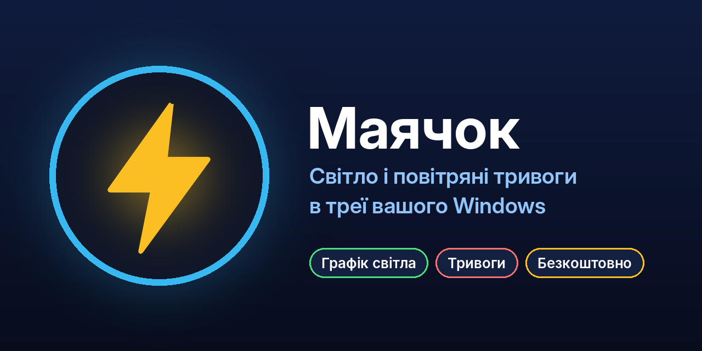

  

# ⚡ Маячок

**Безкоштовна програма для Windows**, яка показує **графік відключень світла** та **повітряні тривоги** у вашій області, прямо в треї. Годинник до відключення, плашки, звук і голос. Тихо, коли ви в грі.

> Статус: **бета**. Програма активно розвивається, оновлюється сама.

## Що вміє
- 💡 **Графік відключень за вашою чергою** (наприклад, 5.2): коли світло зникне, коли повернеться, «жовта зона», коли світло може зникнути.
- 🚨 **Повітряні тривоги** по вашій області: одразу видно, що відбувається.
- 🔔 **Плашки справа вгорі** у 13 стилях (тост із кнопками, «дві тони», рядок, світла тема, неон та інші), звук і голос. Для кожної події можна вибрати: гучно, тихо або вимкнено.
- 🎮 **Режим гри:** на весь екран плашки не з'являються і нічого не згортають, звук лишається. Плашки покажуться після гри.
- 📊 **Підсумки:** тиждень або 30 днів у вигляді календаря, «графік проти факту».
- 🧭 **«Фактично»:** програма бачить, коли світло справді зникло (ноутбук/ДБЖ, раптове вимкнення ПК).
- 📍 **Кілька адрес** (дім, батьки, дача), у кожної свої налаштування.
- 🎨 **Вигляд на ваш смак:** 11 годинників, 6 шрифтів (і власні), стилі плашок.
- 🔄 **Оновлюється сама.**

## Завантаження й установка
1. Відкрийте **[Releases](https://github.com/daskr997/Mayachok/releases/latest)** і завантажте файл `Mayachok_…_Setup.exe`.
2. Запустіть його. Якщо Windows покаже «Windows захистила ваш ПК» (програма без платного підпису): **Докладніше → Виконати в будь-якому разі**.
3. Оберіть область, оператора й свою чергу, перший запуск проведе за руку.

Працює на Windows 10 і 11.

## Приватність
- Налаштування, адреси й статистика зберігаються **лише на вашому комп'ютері**.
- Програма звертається до відкритих джерел (графіки відключень, тривоги), у налаштуваннях показано, до яких саме.
- Звіти про помилки автору надсилаються **за вашою дією або згодою** (без імені, файлів і паролів). Скріншот додається лише якщо ви самі його додали.
- Країна визначається за інтернет-адресою, у Росії та Білорусі програма не працює.

## Знайшли помилку або є ідея?
**Налаштування → Про програму → «Повідомити про помилку»** або **«Запропонувати ідею»**: звіт прилетить автору в Telegram разом із вашим контактом (необов'язково).
Також можна писати сюди: [t.me/maychokua](https://t.me/maychokua?direct).

## Підтримка
Програма безкоштовна. Якщо вона допомогла, можна подякувати, це добровільно: [банка](https://send.monobank.ua/jar/3w22ffZxNZ) 💙

## Умови використання
© 2026 Грибов Владислав Володимирович (daskr997). Усі права захищено. Програма безкоштовна для особистого використання; без письмового дозволу автора заборонено копіювати, розповсюджувати, змінювати, декомпілювати чи продавати програму. Повні умови показуються під час першого запуску.

Створено за допомогою ШІ (Claude, Gemini); ідея, дизайн і тестування — автора.
